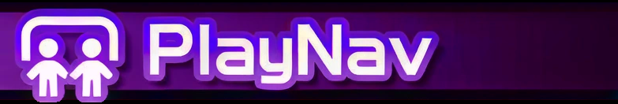
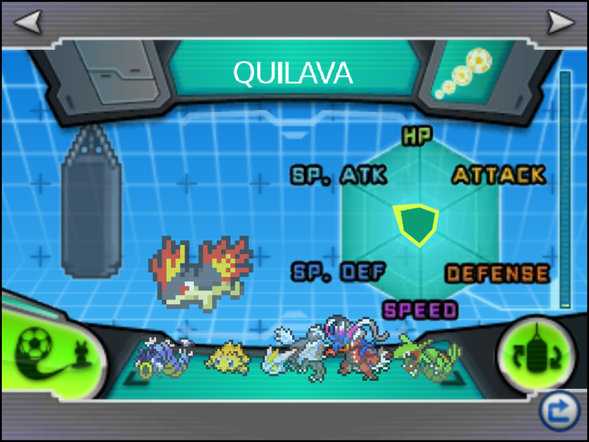
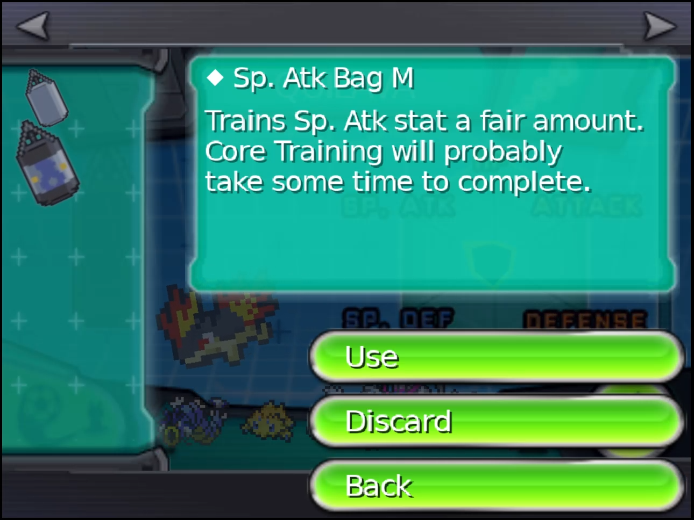
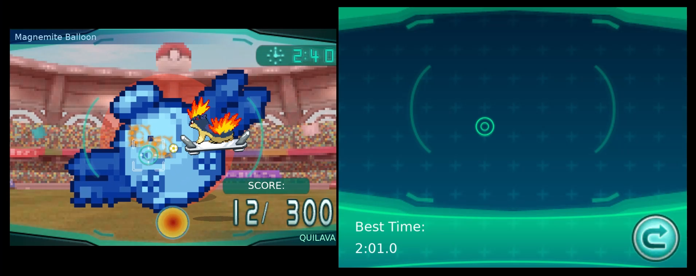

  

*A second screen for your Pokémon. Pet them, feed them Poké Puffs, play games with them and
train them, on a DS-style touch screen in Ruby, Sapphire, Emerald, FireRed and LeafGreen.*

> [!CAUTION]
> **PlayNav is in pre-alpha and experimental.** Expect bugs, missing pieces and balance that
> changes between releases. Back up your save before playing with it, and please report what
> you find.

A mod for [Gen1Recomp](https://github.com/bryanthaboi/gen1recomp)'s Generation 3 games. It
brings **Pokémon-Amie** and **Super Training** from X, Y, Omega Ruby and Alpha Sapphire, played
on a touch screen below the game or on a device's second display.

## 📸 Screenshots

  
  

<em>Core Training and the training bag drawer</em>

  

<em>A Super-Training Regimen: the Balloon Bot on top, the aim screen below</em>

## ✨ Features

### Core Mechanics

- 📱 **A touch screen of your own:** On a single screen (a phone, a PC window) the game and the
  touch screen are laid out like a New 3DS XL: the game as large as it fits, and the touch screen
  at the same height. Held upright, the game is at the top with the touch screen just under it,
  leaving room for the on-screen pad below. Held sideways, the game is on the left and the touch
  screen beside it, both along the top. While you walk the overworld with Super Training's home
  screen open, the touch screen widens to sit on the pad and the overworld fills everything above
  it (or the whole left side, held sideways). On a device with a second display, such as the AYN Thor,
  the touch screen moves there at its sharpest and the game keeps the whole main screen.
  It only appears when you need it, so other mods can use that screen the rest of the time.
- 🧸 **Pokémon-Amie:** Spend time with your Pokémon to raise its affection, and it fights better
  for you.
- 🏋️ **Super Training:** Raise your Pokémon's EVs with training bags and shooting regimens.
- 🖼️ **The real 3DS look and sound, from your own game:** PlayNav builds its art, music, sound
  effects and English text from your own Alpha Sapphire card image. The import is required:
  until it has run, opening Pokémon-Amie or Super Training shows the PlayNav screen with a
  **Begin extraction** button — or a warning that the card image is missing.
- 🔍 **Sharp at any size:** Both screens are drawn at your display's full resolution. The 3DS
  art stays smooth at any size, Pokémon sprites keep their square pixels, and text stays crisp.
  A line too long for its box shrinks to fit. The overworld, battles and the rest of the game
  look exactly as before.

### Pokémon-Amie 💕

- 🏠 **The Amie room:** **AMIE** on the START menu opens a room where your Pokémon wanders,
  plays, naps and asks for food when it's hungry. It's laid out from the game's own screen,
  scalloped frame and all. Tap your Pokémon for **PLAY**, **DECORATE** or **SWITCH** (another
  party member); bubbles over it show how much it wants Poké Puffs and play.
- 🤚 **Petting:** Stroke your Pokémon with your finger. Every species has a spot it loves and
  one it dislikes, and some have spots you shouldn't touch at all: Charmander's tail burns,
  Pikachu's cheeks shock, Regice freezes. Hearts show how much it enjoyed it.
- 🧁 **Poké Puffs:** Drag a puff to your Pokémon and hold it there while it eats, bite by
  bite. There are 26 kinds, from Basic to Supreme, and you win them in battles and games. A
  few Pokémon, like Metapod and Shedinja, can't eat.
- ✋ **Little moments:** Rest a finger beside a fond Pokémon and it gives you a high five. Tap
  twice too fast and it feels hit. It dances as its affection grows and leaves you a present
  each time it gains a heart.
- 🎯 **Three minigames,** picked with the GAMES button on the Play screen:
  - **Berry Picker:** hand each Pokémon the berry it asks for, on the game's own screens: the opening
    demo, the tree and the thought bubbles, TIME'S UP and the berries raining onto the heap, the Poké
    Puffs you won, Play Again or Quit, and the RESULTS card on the top screen.
  - **Head It:** tap Pokémon to bounce yarn, with combos and FEVER.
  - **Tile Puzzle:** swap tiles to rebuild a moving picture. A two-colour border and scattered
    stars and petals show where each tile goes.

  Each game has Easy, Normal, Hard and Unlimited ranks, star ratings and Poké Puff prizes.
- 🛋️ **Décor and visitors:** Decorate the room with any of 34 wallpapers and 172 cushions and
  objects, on the game's own DECORATE screen: slide through your wallpapers with the arrows at
  the top, open **Interior Items** or **Poké Puffs**, and drag what you pick into the room. Let
  it go near one of the spots around the middle and it settles exactly on it; tap a placed item
  to move it again, or drop it in the tray to put it back. Set out a Poké Puff on the middle spot
  (it falls into place when you're back in the room) and visiting Pokémon from your Pokédex drop by. Three that stay
  chat together and leave you a present. Once you've entered the Hall of Fame, they bring you a
  Supreme Honor Poké Puff.
- ⚔️ **Affection in battle:** The fonder your Pokémon, the more it does for you. At two hearts
  it earns more experience. From three it can hang on at 1 HP. From four it can shake off a
  status. At 200 affection foes miss it more, and at five hearts it lands more critical hits.
  From four hearts it also talks to you in battle, in the game's own words: cheering a
  super-effective hit, worrying when its HP runs low, delighted when you heal it, dozing when
  asleep.

### Super Training 🎈

- 🥊 **Core Training:** **TRAINING** on the START menu puts your Pokémon beside a punching bag on
  the touch screen while you keep exploring on the top screen (the blue return button, or TRAINING
  again, closes it; the arrows at the top switch to Pokémon-Amie and back), with the Effort-o-Meter for its base stats and EVs. Tap anywhere in the room to punch the
  bag, one punch at a time. Your Pokémon also punches the bag once a minute on its own, even with the screen
  closed.
- 😴 **Resting:** After half an hour to an hour, or every 3 to 5 bags it clears, whichever comes
  first, it lies down until you tap it. A fainted Pokémon stays down until it is revived.
- 😄 **Second wind:** Woken from a rest, after some cleared bags, from a rare find or the Team
  Flare Bag, it gets a happy bubble and punches with double strength: the next bag takes half
  the taps, or the next regimen scores double. It lasts one bag or one regimen.
- 🏪 **In Kanto Gear's Silph Store:** with Kanto Gear installed, Super Training is also a
  store app — get it, put it on the Gear's home screen, and open it from there.
- 🎁 **The blank bag:** With no training bag set, every punch (yours or your Pokémon's) has a 5%
  chance of digging up a bag, 10% for a Pokémon with all 510 EVs; any bag but the Team Flare
  Bag can turn up, each as likely as the next. A find plays the game's presentation: the new
  bag drops down for a look while your Pokémon celebrates, then it's announced and racked.
- 👜 **26 training bags:** Stat bags in three sizes (+1, +4 and +12 EVs), the Reset Bag, the
  Soothing Bag, and six bags that power up your next regimen. Tap a bag to read about it, then
  use or discard it.
- 🎯 **Super-Training Regimens:** Shoot at the goals on a big Balloon Bot made in the image of a
  real Pokémon, in a stadium, the way the game plays it: the course's title, the balloon pumped
  up on the grass, both names, **Start**, and **Success!** as the balloon zips off into the sky.
  On split screen the picker, the stadium and the results fill the whole top of the screen, as
  the overworld does.
  - **Controls:** tap the touch screen to shoot where you touch (the brackets on both screens
    line up), hold to charge a triple-points shot, and block with L or R. A mark on the top
    screen shows where your last shot went.
  - **Moving:** your Pokémon rides a hover board. Steer it across and up and down with the
    d-pad, anywhere on the screen.
  - **The goals** stay where they appear and move with the balloon. Lv. 1 shows one at a time
    on a gently swaying balloon; higher levels bring groups of three on a balloon that swings
    harder, and a red goal that takes several hits. A hit makes the balloon shake.
  - **The balloon fights back** with soccer balls that grow as they come at you, bigger at
    higher levels. From Lv. 2 it also lobs balls up off the screen: a red shadow on the grass
    shows where each one will land.
  - **Energy Shots:** a full energy meter fires your Pokémon's own Energy Shot.
  - **Your EVs help:** they strengthen your shots, soften hits and make you faster.
  - **The results** show which stat went up on the meter, your time, any new best and the bags
    you won, with the coach's words a tap at a time.
  - **Music:** the regimen picker, every regimen and its results play Super Training's own
    music from your game, in place of the overworld's, which picks up again when you go back.
    It follows the game's sound settings: music volume, audio mode and music filter.
  - **Sound effects:** the regimens play the game's own sounds from your card image, at the
    game's effects volume: from the Regimens button and the balloon's pumps, through every shot,
    hit and attack, to the balloon zipping off as a star and the results.
- 🏆 **30 regimens:** 18 regular courses over three levels, each with the game's own name,
  description, Balloon Bot and score. Tap one to see its card on the top screen. Clear one
  within the target time for an **Award**.
- 🌟 **Secret regimens:** At 510 EVs your Pokémon is **Fully Trained** and twelve secret
  regimens open: multi-bot circuits, sudden death, raging and calming bots, and prizes such as
  Wings, evolution stones, PP Up and PP Max. An Award on every regimen makes it **Supremely
  Trained**.
- 🪶 **Items from later games:** The six stat Wings, the Pretty Wing and the Dusk, Shiny and Dawn
  Stones join the game, with their own icons and descriptions. A Wing used from the bag raises one EV by 1.

## ⚙️ Options

Open **OPTIONS → MODS → PlayNav**.

| Option | Choices | Default | What it does |
|---|---|---|---|
| **POKEMON-AMIE** | On / Off | On | Pokémon-Amie: the AMIE menu entry, and the stat changes from walking and battling. Poké Puffs come from the Amie minigames only, as in the game. |
| **AFFECTION BENEFITS** | On / Off | On | Affection's bonuses in battle. Off for vanilla battles. |
| **SUPER TRAINING** | On / Off | On | Super Training: the TRAINING menu entry. |
| **TOUCH SCREEN SHAPE** | Kanto Gear / 3DS | Kanto Gear | The touch screen's proportions: Kanto Gear's phone (10:9, a little taller), or the 3DS bottom screen (4:3). Every screen keeps the game's art at its own size; on the taller shape the extra room goes to the middle. |
| **TOUCH SCREEN** | Auto / Second Screen / Split Screen / Off | Auto | Where the touch screen goes. Auto uses a second display when there is one, otherwise splits the window. |
| **SHOW TOUCH SCREEN** | When Needed / Always | When Needed | Only while Amie or Super Training is open, or all the time. |
| **HIDE VIRTUAL PAD** | On / Off | On | Hide the on-screen pad while the touch screen is in use. |
| **EXTRACT AMIE ART ON BOOT** | On / Off | On | Unpack the art from your card image automatically on the first start after you add it. |
| **USE EXTRACTED ART** | On / Off | On | Draw with your game's art and text. Off: simple shapes and PlayNav's own wording. |
| **CLEAR EXTRACTED ART** | Press To Clear | Press To Clear | Press it to delete the unpacked art, music, sound and text; the PlayNav screen then shows **Begin extraction** to unpack them again, or the missing-card warning if the card image is no longer imported. In the game it clears at once and reads Press To Clear again; in the launcher it reads Clears At Next Start until you're in the game (press it again to undo). |
| **HD RENDERING** | On / Off | On | Draw both screens at your display's full resolution. Off: the plain low-resolution look. |
| **DEV: SCRATCH APP** | On / Off | Off | A touch test screen for mod makers. |

## 💾 Installation

1. Download the latest release from the [Releases](https://github.com/poooooby/PlayNav/releases)
   page.
2. Import it with the Gen1Recomp Mod Manager, or drop it in your mods folder.
3. Enable **PlayNav**.
4. **For the 3DS art and text (recommended):** open the mod in the launcher, choose
   **Imported files**, then **Choose file**. Pick your own decrypted **Pokémon Alpha Sapphire
   (USA) Rev 2** card image. The launcher accepts only this exact file:

   | | |
   |---|---|
   | **Format** | Decrypted `.cci` |
   | **Size** | 2,147,483,648 bytes (2 GiB) |
   | **MD5** | `0563f9dee1b95de32d579e40c20e2bfc` |

   The launcher checks it and keeps a private copy. On the next start the PlayNav screen
   unpacks the art, music, sound effects and text with a progress bar — a few seconds, in the
   background while you play — then tells you the copy can be removed under Imported files.
   If the automatic start is off, the same screen offers **Begin extraction** whenever you
   open Pokémon-Amie or Super Training.

## 🔗 Works With

- [Kanto Gear](https://github.com/AverageConsumer/kanto-gear): touch battle commands, bag and
  pad. PlayNav doesn't do controls; the two share the second display. With **SHOW TOUCH
  SCREEN** on When Needed, PlayNav has the second display while Amie or Super Training is open
  and Kanto Gear is back on it the moment you close them.
- [National Dex Gen 3](https://github.com/poooooby/national_dex_gen3): the real Dusk, Shiny and
  Dawn Stones with their evolutions. Super Training's stone prizes become those stones.
- [G9 Battle Sprites (Gen 3)](https://github.com/poooooby/g9-battle-sprites-gen3): with sprites
  for the newer species, the Generation 4-6 Balloon Bots (Aegislash, Stunfisk, Hydreigon and
  more) use them instead of their course badge.

## 📌 Good to Know

- 🧪 **Pre-alpha:** Some Super Training numbers have no public source. Points per goal,
  damage, timings and bag odds are best guesses and may change.
- 🎮 **Generation 3 only.** Ruby, Sapphire, Emerald, FireRed and LeafGreen.
- 💾 **Your game is never part of the mod.** The art and text come from the card image you
  supply, unpacked on your own device. Encrypted or compressed images (such as Azahar's `.zcci`)
  aren't accepted yet; supply the plain `.cci`.
- 🖱️ **On a PC with a second-display window,** strokes don't come through, only taps, so
  petting needs Split Screen there. A real second panel, like the AYN Thor's, works
  fully.
- 🧁 **Every Pokémon takes three bites** of a puff, and petting spots cover broad areas (head,
  face, belly...) rather than exact pixels.
- 🪶 **The Wings and stones** are items the original game doesn't have. If you remove PlayNav, a save
  that holds them shows them as numbers.
- 🔁 **Coming from DS Touch?** PlayNav was called DS Touch in its early test builds. Your
  affection, puffs, Décor and training records carry over by themselves on the first load, and
  the art is unpacked once more.

## 🪪 Credits

- **Pokémon-Amie and Super Training data** (petting spots, Décor names, stat and minigame rules,
  Energy Shot colours, course and bag tables):
  [Bulbapedia](https://bulbapedia.bulbagarden.net/), licensed
  [CC BY-NC-SA 2.5](https://creativecommons.org/licenses/by-nc-sa/2.5/).
- **Super Training research:** the Japanese guides at pente.koro-pokemon.com, the ORAS atwiki
  and gamepedia.jp, and the ORAS Wiki.
- **Wing and stone icons:** [PokéSprite](https://github.com/msikma/pokesprite) (the images are
  © Nintendo / Creatures Inc. / GAME FREAK Inc.; see `assets/credits.txt`). Their names
  and descriptions come from [PokeAPI](https://pokeapi.co).
- **Super Training stadium and hover board:** original art by Wooble for PlayNav.

## 💡 Inspirations

- **Pokémon X, Y, Omega Ruby and Alpha Sapphire**, whose Pokémon-Amie and Super Training this
  recreates as closely as the public record allows.

## 🤖 AI Disclosure

This mod was developed with help from [Claude Code](https://claude.com/claude-code) (Anthropic),
working from the maintainer's direction, design decisions, in-game testing and bug reports. The
maintainer approves every release. If you find a bug, please open an issue here or on Discord.

---

The mod's code is [MIT](LICENSE). Data drawn from Bulbapedia keeps its CC BY-NC-SA 2.5 licence,
and the item icons belong to their owners. Pokémon is © Nintendo, Game Freak and The Pokémon Company;
this is an unofficial fan project. See the [CHANGELOG](CHANGELOG.md) for what each release
brought. Working on the mod? See [DEVELOPMENT.md](DEVELOPMENT.md).
