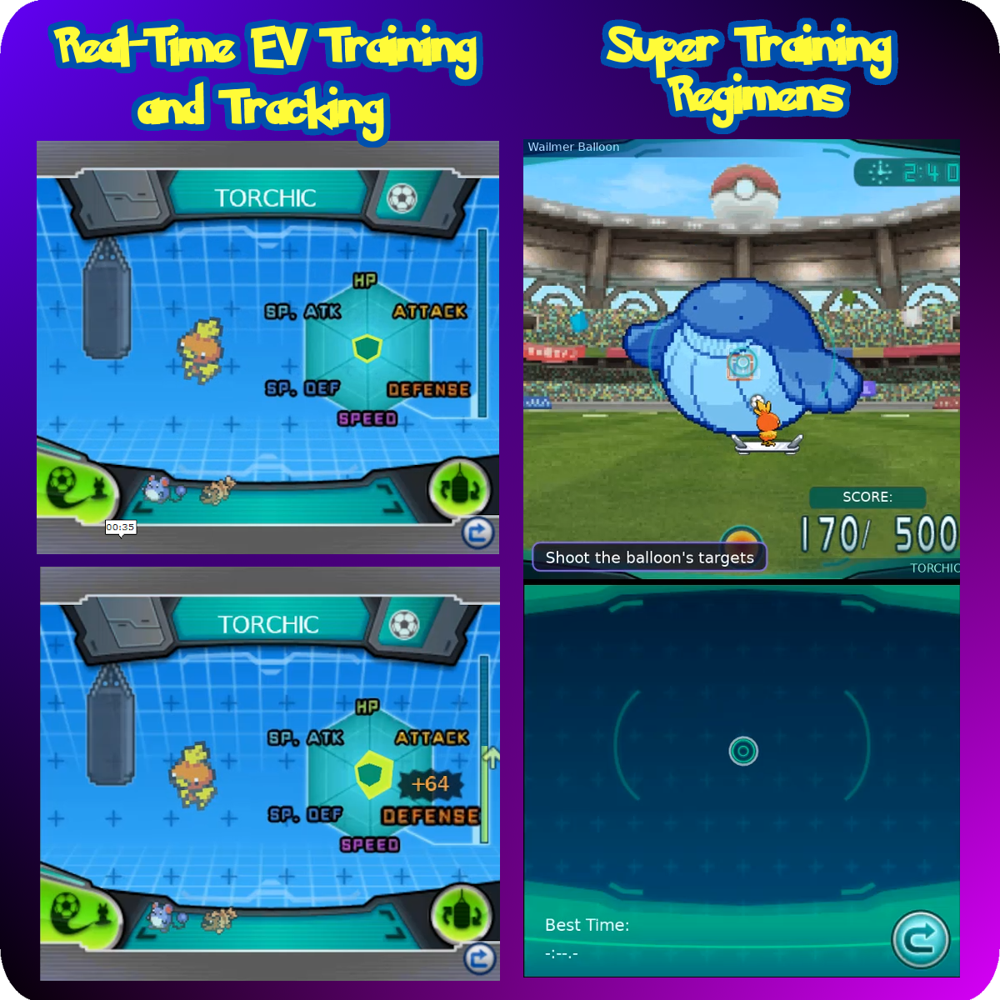
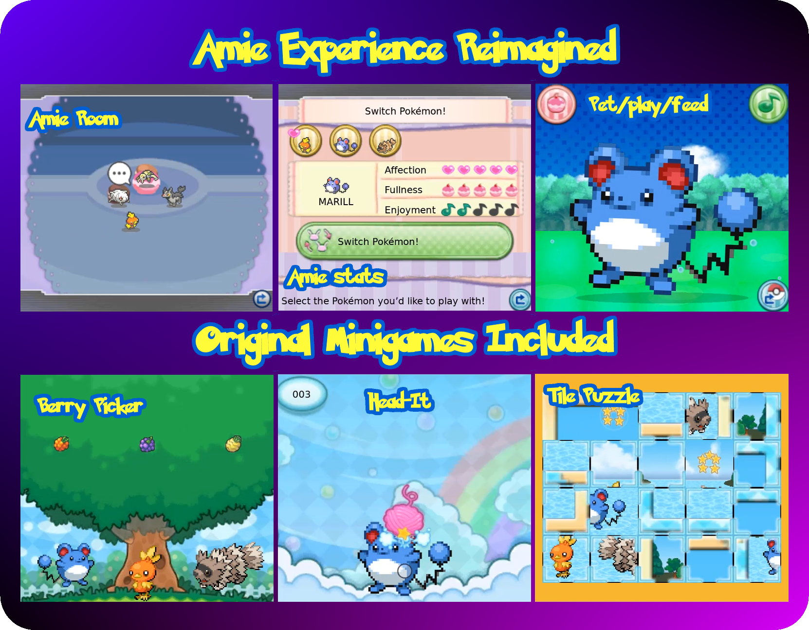
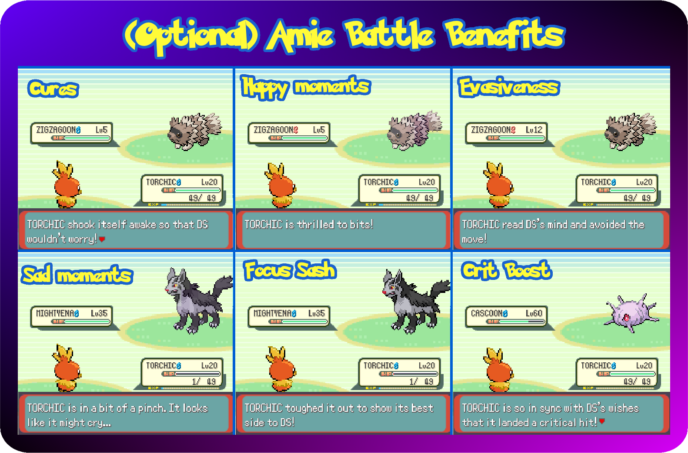
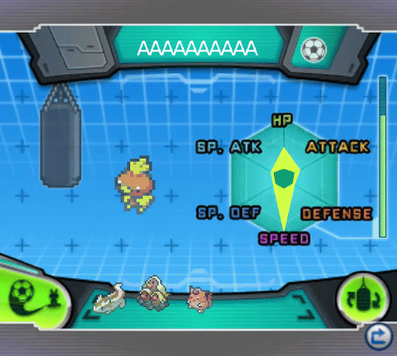
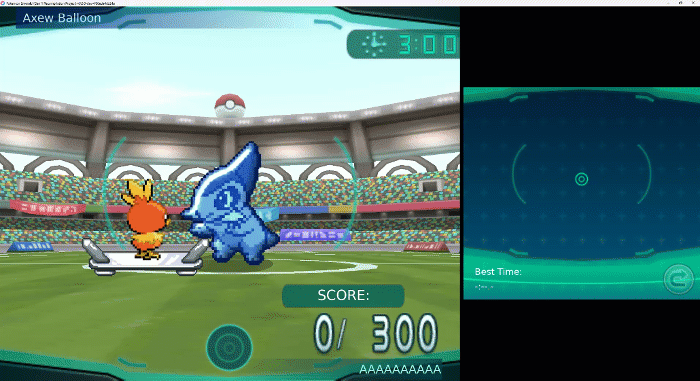
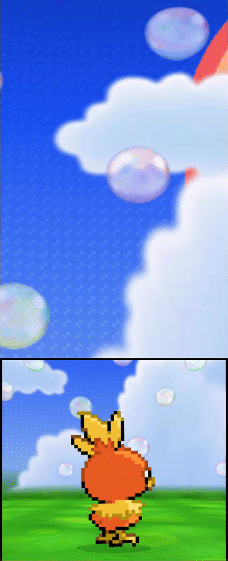
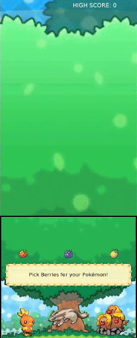
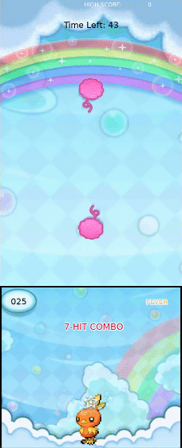
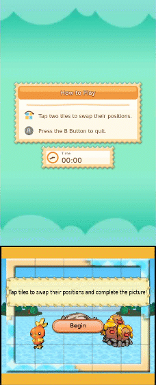

<h1 align="center">NaviPlay</h1>

*A second screen for your Pokemon. Pet them, feed them, play games with them and
train them, on a DS-style touch screen.*

A mod for [Gen1Recomp](https://github.com/bryanthaboi/gen1recomp)'s Generation 1, 2 and 3 games. It
brings **Pokemon-Amie** and **Super Training** from X, Y, Omega Ruby and Alpha Sapphire, played
on a touch screen, DS-style handheld, or nestled in a PC window.

## What's Included

  
  
  

## Screenshots

### Super Training

  
  
  

<em>Core Training, punching a training bag, and a Regimen in the 3D stadium</em>

### Pokemon-Amie

<table align="center">
  <tr>
    <td align="center"></td>
    <td align="center"></td>
    <td align="center"></td>
    <td align="center"></td>
  </tr>
  <tr>
    <td align="center"><em>Petting</em></td>
    <td align="center"><em>Berry Picker</em></td>
    <td align="center"><em>Head It</em></td>
    <td align="center"><em>Tile Puzzle</em></td>
  </tr>
</table>

## Features

### Core Mechanics

- **A touch screen of your own:** It appears only when you call NaviPlay, laid out exactly as
  Kanto Gear lays out its own screen, with the same Display Mode choices: **Fullscreen Swap**
  (NaviPlay or the game fills the window, Y swaps them), **Combined Screen** (stacked, side by side,
  or a panel over the game) or **Separate Screens** (a second display, such as the AYN Thor's).
  With **K-Gear** it simply follows Kanto Gear's settings, so switching between the two is
  seamless. The touch screen is always drawn at your display's full sharpness.
- **Pokemon-Amie:** Spend time with your Pokemon to raise its affection, and it fights better
  for you.
- **Super Training:** Raise your Pokemon's EVs with training bags and shooting regimens.
- **Your choice of look and sound:** the first time you open NaviPlay its screen asks.
  **Begin extraction** builds the art, music, sound effects and English text from your own Alpha
  Sapphire or Omega Ruby copy, for the real 3DS look. **Use fallback assets** needs no copy:
  every screen is drawn by NaviPlay itself, with its own sounds and words and the GBA games' own
  songs for music. Switch between the two any time with **USE ROM ASSETS**.
- **The NaviPlay menu:** **NAVIPLAY** on the START menu opens NaviPlay on the touch screen,
  with a card for each app (**Pokemon-Amie** and **Super Training**) as the game's PlayNav lists
  them. Tap one to open it; closing an app brings you back to the menu, and the x (or NAVIPLAY
  again) closes it.
- **Haptics:** On a phone or handheld you feel your touches: a tick for menu presses, a
  pulse for a good stroke, a bite or a hit that lands, two knocks when your Pokemon doesn't like
  it or you miss, and a burst for a cleared bag, a finished puzzle or a popped Balloon Bot. Set
  how strong in the options, or turn it off.
- **Sharp at any size:** Both screens are drawn at your display's full resolution. The 3DS
  art stays smooth at any size, Pokemon sprites keep their square pixels, and text stays crisp.
  A line too long for its box shrinks to fit. The overworld, battles and the rest of the game
  look exactly as before.

### More

- 💕 [**Pokemon-Amie**](docs/Pokemon-Amie.md): the room, Play, petting, Puffs, the three
  minigames, Decor and visitors, and affection in battle.
- 🎈 [**Super Training**](docs/SuperTraining.md): Core Training, training bags, the
  Super-Training Regimens and their prizes.

## ⚙️ Options

Every option and what it does: [Options](docs/Options.md).

## 💾 Installation

How to install NaviPlay and, optionally, add the 3DS art and text: [Installation](docs/Installation.md).

## 🔗 Works With

- [Kanto Gear](https://github.com/AverageConsumer/kanto-gear): touch battle commands, bag and
  pad. NaviPlay doesn't do controls; the two share the second display. NaviPlay has it only while
  the NaviPlay menu, Amie or Super Training is open, and Kanto Gear is back on it the moment you
  close them. Pokemon-Amie and Super Training are
  also apps in the Gear's Silph Store: get them, put them on the Gear's home screen, and open
  them from there.
- [National Dex Gen 3](https://github.com/poooooby/national_dex_gen3): the real Dusk, Shiny and
  Dawn Stones with their evolutions. Super Training's stone prizes become those stones.
- [G9 Battle Sprites (Gen 3)](https://github.com/poooooby/g9-battle-sprites-gen3): your
  Pokemon show its sprites in Pokemon-Amie and Super Training, each animated sprite held in one
  still pose.

## 📌 Good to Know

- 🧪 **Faithful, tuned for touch:** Super Training's rules, damage, attacks, balloon sizes and
  timings are read from the game's own code and data, and checked against recordings of the game;
  on the flat view a few things are tuned for a flat touch screen (bigger hitboxes you can see,
  homing you can outrun, quicker movement), while the 3D stadium plays them the game's way.
- 🎮 **Generations 1, 2 and 3.** Red, Blue, Yellow, Gold, Silver, Crystal, Ruby, Sapphire,
  Emerald, FireRed and LeafGreen. NaviPlay finds out which game it is on by itself.
- 🕹️ **On Gen 1 and 2,** Super Training works in those games' Stat Exp: a stat holds up to 252
  EVs (Stat Exp 63,504, the stat's full bonus), there is no 510 total, and Sp. Atk and Sp. Def
  bags and regimens train the one Special stat. A Pokemon is Fully Trained with all five stats
  at 252. Your Pokemon are drawn with Pokemon Crystal's sprites.
- 💾 **Your copy of the game is never part of the mod.** The 3DS art and text come from the
  card image you supply, unpacked on your own device. Encrypted dumps (a raw cartridge dump, an eShop `.cia`)
  can't be read; supply a decrypted one. Azahar's compressed `.zcci` works as it is.
- 🖱️ **On a PC with a second-display window,** strokes don't come through, only taps, so
  petting needs Split Screen there. A real second panel, like the AYN Thor's, works
  fully.
- 🤚 **Petting spots** cover broad areas (head, face, belly...) of the sprite rather than exact
  pixels, and the visitors are Pokemon from your Pokédex rather than other players'.
- 🪶 **The Wings and stones** are items the original game doesn't have. If you remove NaviPlay, a save
  that holds them shows them as numbers.

## 🪪 Credits

- **Pokemon-Amie and Super Training data** (petting spots, Décor names, stat and minigame rules,
  Energy Shot colours, course and bag tables):
  [Bulbapedia](https://bulbapedia.bulbagarden.net/), licensed
  [CC BY-NC-SA 2.5](https://creativecommons.org/licenses/by-nc-sa/2.5/).
- **Super Training research:** the Japanese guides at pente.koro-pokemon.com, the ORAS atwiki
  and gamepedia.jp, and the ORAS Wiki.
- **Wing and stone icons:** [PokéSprite](https://github.com/msikma/pokesprite) (the images are
  © Nintendo / Creatures Inc. / GAME FREAK Inc.; see `assets/credits.txt`). Their names
  and descriptions come from [PokeAPI](https://pokeapi.co).
- **Super Training stadium and hover board, the Amie cottage and play sky, and the regimen
  picker's music, along with other sprites and music:** original art and music by Wooble for
  NaviPlay.
- **Balloon Bot sprites:** the Gen 9 Pack's Pokemon battler sprites — Gen 1-5 Pokemon by
  veekun, Gen 6 Pokemon by all contributors to the Smogon X/Y Sprite Project.
- **Gen 1 and 2 Pokemon sprites:** Pokemon Crystal's fronts and backs, from the
  [Crystal Animated Sprites with Shiny Visuals](https://github.com/distilledorion-sketch/crystal_animated_sprites_with_shiny_visuals)
  mod by distilledorion-sketch.
- **Pokemon-Amie's Décor, wallpapers, Poké Puffs, hand and minigame art** (used without a card
  image): from Pokemon X and Y (© The Pokemon Company), provided via The Spriters Resource.
- **Tile Puzzle's trees and PLAY's treeline:** TREE PIXEL PACK and PIXEL BUSHES PACK by
  [AstroCom](https://astrocom.space). **PLAY's lawn:** the GRASS+ tile sheet by SciGho.
- **The split-screen layout** is adapted from [Kanto Gear](https://github.com/AverageConsumer/kanto-gear)'s
  by AverageConsumer, with permission (MIT).

Details for every bundled file are in `assets/credits.txt`.

## 💡 Inspirations

- **Pokemon X, Y, Omega Ruby and Alpha Sapphire**, whose Pokemon-Amie and Super Training this
  recreates as closely as the public record allows.

## 🤖 AI Disclosure

This mod was developed with help from [Claude Code](https://claude.com/claude-code) (Anthropic),
working from the maintainer's direction, design decisions, in-game testing and bug reports. The
maintainer approves every release. If you find a bug, please open an issue here or on Discord.

---

The mod's code is [MIT](LICENSE). Data drawn from Bulbapedia keeps its CC BY-NC-SA 2.5 licence,
and the item icons and Pokémon-Amie art belong to their owners. Pokémon is © Nintendo, Game Freak and The Pokémon Company;
this is an unofficial fan project. See the [CHANGELOG](CHANGELOG.md) for what each release
brought. Working on the mod? See [DEVELOPMENT.md](DEVELOPMENT.md).
